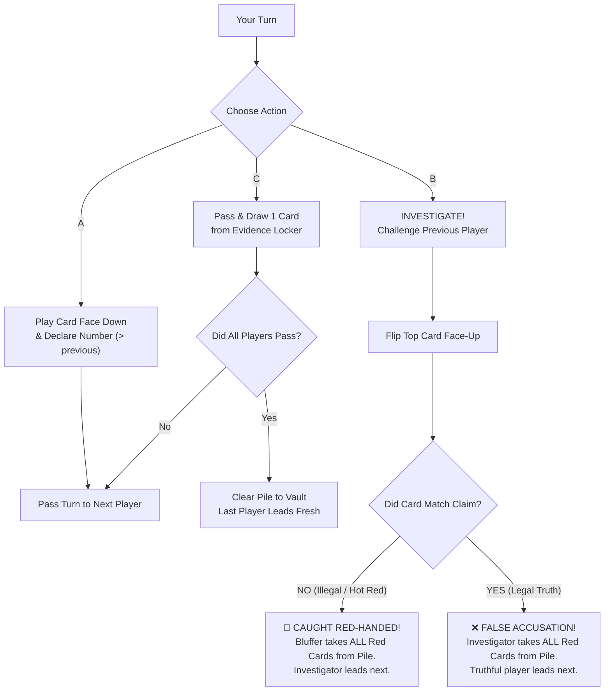

# 🚨 Caught Red-Handed V2: The Interrogation

**A High-Stakes Face-Down Bluffing, Climbing & Investigation Card Game**  
*Players*: 3–6 (Optimized for 3–5) | *Ages*: 8+ | *Match Length*: ~15–25 mins | *Components*: 54 Play Cards + 2 Reference Cards

---

## 1. The Core Premise: "Play It Cool or Face the Heat!"

You and your syndicate crew have pulled off a multi-million-dollar heist, but the feds are closing in fast. The center table is the **Evidence Pile**. To escape in the getaway car, you must **shed every single card from your hand**.

* Every card is played **FACE DOWN**.
* As you play, you must look your fellow thieves in the eye and **declare what card you claim to have played**.
* The declared number must be **strictly higher** than the previously declared number ($> X$).
* **The Contraband Trap**: 
  * **Clean Loot (Blue)** has numbers $1$ to $10$. Safe to play truthfully or bluffed.
  * **Numbered Contraband (Red)** has low numbers $1$ to $6$. Hot goods that *can* be played legally if the count is low!
  * **Unnumbered Contraband (Red `🚨 HOT EVIDENCE`)** has **NO NUMBERS AT ALL**. These cards are pure toxic evidence—they can **never** be played legally! To shed them, you **MUST BLUFF**!
* **Instead of playing a card, you may shout: "INVESTIGATE!"**
  * If the previous player was **lying / illegal**: They are **CAUGHT RED-HANDED**! They must take **ALL Red Contraband cards from the Evidence Pile into their personal Penalty Pile**!
  * If the previous player was **telling the truth**: You made a **FALSE ACCUSATION**! You must take **ALL Red Contraband cards from the Evidence Pile into your personal Penalty Pile**!
  * All Blue loot cards in the pile are secured and cleared away to the vault.
* **The Getaway Race**: The first player to shed their last card triggers the **Getaway Car**! All remaining players reveal their hands:
  $$\text{Total Contraband} = (\text{Red Cards in Hand}) + (\text{Red Cards in Penalty Pile})$$
  The player(s) caught holding the most Red Contraband receive a **Mugshot Strike** (🚨 BUSTED!). **3 Strikes and you are sent to Federal Prison!**

---

## 2. Deck Anatomy (54 Play Cards + 2 Reference Cards)

The deck consists of exactly **54 Play Cards** (printed on 6 standard 9-card sheets) plus 2 Reference Cards:

```
36 Clean Loot (Blue) + 8 Numbered Red (1-6) + 6 Hot Evidence (Red) + 4 Resets (0) = 54 Play Cards
```

### A. Clean Loot (Blue) — 36 Cards
* Values $1$ through $10$:
  * **3 copies each**: Values 1, 2, 9, 10 (12 cards)
  * **4 copies each**: Values 3, 4, 5, 6, 7, 8 (24 cards)
* **Safe goods**: Blue cards carry zero penalty points. When cleared during an investigation or sweep, they go into the Vault (out of the round).

### B. Numbered Contraband (Red) — 8 Cards
* Values $1$ through $6$:
  * **2 copies**: Red 1 (Petty Contraband)
  * **2 copies**: Red 2 (Petty Contraband)
  * **1 copy each**: Red 3, Red 4, Red 5, Red 6 (Larceny / Syndicate Contraband)
* **The Double-Edged Sword**: If you have a Red 4 and the current bid is 2, you can honestly declare "Four!" and play it legally! If someone investigates you, they eat the penalty! But if caught in your hand at the end of the round, it counts toward your strike!

### C. Unnumbered Contraband (Red `🚨 HOT EVIDENCE`) — 6 Cards
* Value: **NONE** (`🚨 HOT EVIDENCE` / Syndicate Seal).
* **Pure Toxic Goods**: These cards have no numerical rank. They can **never** match any number declaration!
* To get rid of a Hot Evidence card, you **must bluff** by declaring a number higher than the previous card (or claiming a Reset).

### D. Tactical Resets (0 / Special) — 4 Cards
* **The Fence (2 cards, Value 0 🤝)**: Resets the declared count back to 0. (The next player may declare any number $\ge 1$).
* **Smoke Bomb (2 cards, Value 0 💨🔄)**: Resets the declared count back to 0 **AND reverses the direction of play** (Clockwise ↔ Counter-Clockwise)!
* Can be played legally by declaring "Reset" or "The Fence" / "Smoke Bomb".

---

## 3. Setup (30 Seconds)

1. Shuffle all 54 play cards thoroughly.
2. Deal **7 cards** face down to each player.
3. Place the remaining cards face down in the center as the **Evidence Locker (Draw Pile)**.
4. Leave room in the center for the face-down **Evidence Pile**, and a discard space for the **Vault**.
5. Give each player a **Mugshot Tracker** (or use tokens for 3 Strikes).
6. The player who most recently committed a petty crime (or random draw) goes first. Initial play direction is **Clockwise**.

---

## 4. Turn Structure

On your turn, you must take **ONE** of three actions:



### Action A: Play Face Down & Declare
1. Select **1 card** from your hand and place it **face down** onto the center Evidence Pile.
2. **Make your declaration aloud**:
   * **If declaring a number**: Your number must be **strictly greater** than the currently active declared number ($> X$).
     * *Example*: If the active declaration is "5", you may declare "6", "7", "8", "9", or "10".
     * *(If the pile is empty or was just reset to 0, you may declare any number $1$ through $10$)*.
   * **If declaring a Reset**: You must declare "Reset" (or "The Fence" / "Smoke Bomb").
3. Your play is now pending! Turn passes to the next player.

### Action B: Investigate! (Call Bluff)
If you suspect the player immediately before you was lying, shout: **"INVESTIGATE!"**

1. **Flip the top card of the Evidence Pile face up for everyone to see**:
2. **Determine the verdict**:
   * **🚨 CAUGHT RED-HANDED! (Play was ILLEGAL)**:
     * The card did **not** match the declaration (e.g. they claimed "7", but the card is a 3, a Blue 9, a Reset, or an unnumbered `🚨 HOT EVIDENCE` card).
     * **Penalty**: The bluffer must pick up **ALL Red Contraband cards** currently in the entire Evidence Pile (including the flipped card) and place them face up in their personal **Penalty Pile**!
     * **Loot Secured**: All Blue cards and Resets in the Evidence Pile are swept into the **Vault** (cleared from play).
     * **Next Lead**: The successful Investigator leads the next turn on a fresh, empty pile!
   * **❌ FALSE ACCUSATION! (Play was LEGAL)**:
     * The card **did** match the declaration (e.g. they claimed "7", and the card is actually a 7—whether Blue 7 or Red 7!).
     * **Penalty**: The **Investigator** must pick up **ALL Red Contraband cards** currently in the Evidence Pile and place them face up in their personal **Penalty Pile**!
     * **Loot Secured**: All Blue cards and Resets are swept into the **Vault**.
     * **Next Lead**: The truthful player who was falsely accused leads the next turn on a fresh, empty pile!

*(Note: If a Smoke Bomb was revealed during an investigation and proved legal, reverse turn direction immediately)*.

### Action C: Pass & Draw 1 Card
If you cannot beat the current number (e.g. it is at 10), or do not want to bluff, and do not want to investigate:
1. **Draw 1 card** from the Evidence Locker into your hand.
2. Your turn ends.
3. **Table Sweep Rule**: If all players consecutively pass without playing or challenging, the Evidence Pile is secured! All cards in the pile are swept into the Vault with zero penalties, and the player who played the uncontested top card leads fresh.

---

## 5. Round End: The Getaway Car

A round ends when any player plays their **very last card** from their hand!

### The Final Inspection
1. When a player plays their last card, the next player in turn order has the immediate option to **Investigate** it!
2. **If Investigated**:
   * If the player was **bluffing** $\rightarrow$ They are caught red-handed! They take all Red cards in the pile into their penalty pile, pick their bluffed card back up into their hand, and **do NOT escape**! Play continues!
   * If the player was **telling the truth** $\rightarrow$ False accusation! The investigator takes all Red cards into their penalty pile. The player's escape is sealed!
3. **If Not Investigated (or passed)** $\rightarrow$ The player shouts:
   > 🚗💨 **"GETAWAY CAR!"**

### Contraband Tally & Strikes
The escaped driver gets away scot-free (**0 Strikes**)!  
All other players must freeze and reveal all cards in their hand and personal penalty pile:

$$\text{Player Contraband Score} = (\text{Red Cards in Hand}) + (\text{Red Cards in Penalty Pile})$$

* The player(s) with the **HIGHEST Contraband Score** receive **1 Mugshot Strike**!
* *(In the event of a tie for highest score, all tied players receive 1 Strike)*.
* *(If no remaining players hold any Red cards, no strikes are awarded)*.

---

## 6. Winning the Game

* When any player accumulates **3 Mugshot Strikes**, the game ends immediately!
* That player is **SENT TO FEDERAL PRISON**!
* The player with the **fewest Mugshot Strikes** (most successful escapes and least contraband) is crowned the **Syndicate Mastermind**!

---

## 7. Mastermind Tactics & Bluffing Psychology

1. **The Numbered Red Gambit**: Because Red cards 1 through 6 have printed numbers, you can play them *truthfully*! When someone plays a 2, playing a Red 4 and boldly announcing "Four!" is 100% legal. If an opponent thinks you're dumping contraband and challenges you, they eat the penalty!
2. **The Hot Evidence Dump**: Unnumbered `🚨 HOT EVIDENCE` cards are pure toxic waste. You *must* bluff to shed them. The best time to dump them is early in a sequence (e.g. declaring a 3 or 4) when opponents are reluctant to risk challenging for just 1 or 2 cards in the pile.
3. **Escalation & the Snowball**: As the Evidence Pile grows to 5, 6, or 7 cards, the risk of challenging multiplies. If you suspect there are 3 Red cards buried in that pile, a false accusation is catastrophic! Use that fear to bluff higher numbers with impunity.
4. **Card Counting**: There are only 3 copies of 9 and 10 in the entire deck. If you hold two 10s in your hand and someone confidently declares "10", there is a 66% chance they are bluffing!
